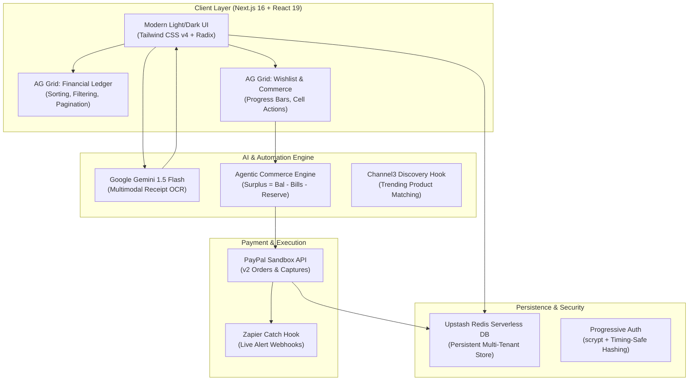

# ReceiptMind (Tinku) — AI Financial Co-Pilot & Agentic Commerce

> **Translating budget discipline into guilt-free rewards with AG Grid, PayPal Sandbox, and AI-driven emergency reserve protection.**

---

## 📌 Project Overview
- **Project Name:** ReceiptMind (Tinku)
- **Tagline:** Autonomous agentic commerce and personal finance co-pilot powered by AG Grid, PayPal Sandbox, and Google Gemini AI.
- **Live Deployment:** [https://receiptmind-two.vercel.app](https://receiptmind-two.vercel.app)
- **GitHub Repository:** [https://github.com/Anubhavsaxena2004/receiptmind](https://github.com/Anubhavsaxena2004/receiptmind) (MIT License)
- **Target Hackathon Tracks:**
  1. 🏆 **Best Use of AG Grid** ($5,000 / $2,000 / $1,000)
  2. 🏆 **Best Use of Agentic Commerce** ($5,000)
  3. 🏆 **Best Use of PayPal + AI** ($5,000)
  4. 🏆 **Best Use of Channel3** ($1,500)

---

## 💡 Inspiration
Traditional budgeting apps make people feel guilty about every purchase. Users diligently categorize expenses, set limits, and cut corners, but they are rarely rewarded for good financial behavior. When they finally want to treat themselves to a new mechanical keyboard, headphones, or a gift for a loved one, the fear of *"Can I really afford this without dipping into rent or my emergency fund?"* causes paralyzing anxiety.

We asked: **What if an AI agent didn't just track your money, but actively worked for you?**
What if your budget savings autonomously unlocked personal wishlist goals—guaranteeing that your emergency fund and upcoming bills remain 100% untouched—and allowed you to fulfill those goals immediately via PayPal?

That is **ReceiptMind (Tinku)**: an intelligent, proactive financial co-pilot that bridges personal budgeting with **Agentic Commerce**.

---

## 🚀 What It Does

1. **Intelligent Receipt Scanning (Multimodal AI OCR):**
   - Users snap a picture or upload an invoice of any bill or receipt.
   - Built on **Google Gemini 1.5 Flash**, the system extracts merchant name, date, line items, and total amount with zero manual entry.

2. **Dual High-Performance AG Grid Tables:**
   - **Financial Ledger Grid (`/expenses`):** An enterprise-grade, lightning-fast spreadsheet view of all transactions with real-time column sorting, category filtering, search, and custom currency badges.
   - **Interactive Agentic Wishlist Grid (`/wishlist`):** A custom AG Grid interface featuring animated surplus progress bars, priority tags (High, Medium, Low), and an interactive **"Pay with PayPal"** action button embedded directly inside the cell renderer.

3. **Autonomous "Guilt-Free" Surplus Engine:**
   - The agent continuously evaluates:
     $$\text{Safe Surplus} = \text{Current Balance} - \text{Bills Due (Next 14 Days)} - \text{Protected Emergency Reserve}$$
   - If liquidity dips below the user's emergency threshold or upcoming obligations, all wishlist rewards remain strictly locked.
   - As budget discipline creates savings, the surplus dynamically fills progress bars for ranked wishlist items.

4. **One-Click Agentic Commerce with PayPal Sandbox:**
   - When a wishlist goal is 100% funded by safe surplus, the AI unlocks it.
   - The user triggers checkout directly via **PayPal Sandbox** (converting INR to fair USD equivalent with idempotency protection).
   - Once captured, the ledger updates automatically, an expense is recorded, and balance is deducted—leaving the emergency reserve completely safe.

5. **Automated Event-Driven Zapier Webhooks:**
   - Every confirmed purchase, bill payment, and AutoPay run immediately forwards a structured JSON payload to our live Zapier catch hook (`hooks.zapier.com/hooks/catch/...`).
   - This enables users to trigger instant alerts across Slack, email, WhatsApp, or Google Sheets.

6. **Crisis Drill Simulation Mode:**
   - Users can stress-test their finances under real-world shocks (e.g., job loss, medical emergency, income cut). The app runs an immediate resilience score, freezes non-essential commerce, and prioritizes vital bills.

---

## 🛠️ How We Built It

### Architecture Overview

### Tech Stack
- **Framework:** Next.js 16.3.3 (App Router, Server Actions) & React 19
- **Data Grids:** AG Grid Community (`ag-grid-react` & `ag-grid-community` v35.3.1 with custom Quartz theme)
- **AI & Multimodal OCR:** Google Gemini 1.5 Flash (`@google/genai`) with Anthropic Claude 3.5 Sonnet fallback
- **Payments:** PayPal Sandbox REST APIs (v2 Orders, Authorizations, Captures)
- **Workflow Automation:** Webhooks by Zapier (Live Catch Hook Integration)
- **Database:** Upstash Redis (Serverless KV store with JSON data isolation)
- **Styling:** Tailwind CSS v4, Lucide Icons, Shadcn UI primitives, responsive mobile light-mode enforcement
- **Testing:** Standalone Node.js ESM test matrix (`32 passed, 0 failed`)

---

## 📊 AG Grid Implementation Deep Dive
*(Targeting Best Use of AG Grid)*

We leveraged AG Grid Community v35 to provide users with an uncompromising financial dashboard:

1. **Custom Cell Renderers:**
   - `TitleCell`: Renders multi-line titles with outbound product links and user intention notes.
   - `PriorityCell`: Dynamic status badges rendering high-contrast warning/danger/neutral tags.
   - `ProgressCell`: An interactive progress bar computing real-time surplus coverage percentage, showing remaining amounts to save.
   - `ActionCell`: Embeds an asynchronous Server Action button (`executeWishlistPurchase`) directly within the grid row, enabling instant PayPal Sandbox checkout.
2. **Enterprise Styling & Theme Integration:**
   - Configured with `themeQuartz.withParams(...)` dynamically mapped to CSS design tokens (`var(--primary)`, `var(--card)`, `var(--foreground)`, `var(--border)`).
3. **Performance & Ergonomics:**
   - Client-side pagination (10 items/page), smooth animated rows, full-width responsive resizing, and auto-filtering.

---

## 🔒 Security & Payment Robustness

To ensure financial integrity, we built an exhaustive 32-point test suite (`scripts/test-payment-flows.mjs`):
- **Timing-Safe Crypto:** Passwords hashed with `scrypt` using unique salts and `crypto.timingSafeEqual`.
- **PayPal Order Verification:** Cryptographically validates order status, verifies that transaction currency is USD, ensures amounts match expectations, and checks that multi-tenant `custom_id` belongs to the requesting user.
- **Idempotency Safeguards:** Every payment generates a unique idempotency key preventing double-charging on network retries.
- **Zapier Privacy Filter:** Webhook payloads strictly transmit event summaries and links; private credentials, session tokens, and passwords are never exposed.

---

## 🧗 Challenges We Ran Into
- **Strict Liquidity Constraint Formulation:** Calculating what constitutes "safe to spend" without risking an overdraft is mathematically nuanced. We solved this by creating a 14-day lookahead window for recurring bill occurrences and deducting that alongside the user's inviolable emergency fund.
- **Cross-Currency FX Alignment:** Since household finances in our demo use INR while PayPal Sandbox accounts operate predominantly in USD, we implemented real-time currency conversion with a minimum floor ($0.01) and custom exchange rate tracking.

---

## 🏆 Accomplishments We're Proud Of
- **True Agentic Commerce:** Rather than simple passive tracking, the AI actively tells users *when* they can safely purchase their dreams.
- **Dual AG Grid Deployment:** Seamlessly embedding interactive data grids into both expense tracking and reward goal fulfillment.
- **Zero-Cost High-Speed OCR:** Integrating Google Gemini 1.5 Flash so users can scan unlimited receipts without incurring heavy API bills.
- **32/32 Tests Passing:** Rock-solid test suite verifying edge cases in currency conversion, state machines, and AutoPay rules.

---

## 📚 What We Learned
- How to write custom AG Grid cell renderers that interact seamlessly with Next.js Server Actions and optimistic UI states.
- The power of combining PayPal Sandbox with automated event-driven webhooks (Zapier) to turn every financial transaction into a multi-channel notification.
- How to design financial interfaces that encourage mindfulness and reward positive behavior instead of inducing budgeting fatigue.

---

## 🔮 What's Next for ReceiptMind (Tinku)
- **Autonomous PayPal Subscriptions:** Enabling AI-managed recurring subscriptions that pause automatically when emergency liquidity is compromised.
- **Direct Merchant Price Tracking:** Integrating Channel3 web scrapers to monitor wishlist items and alert the user when a flash sale aligns with their surplus.
- **Collaborative Family Vaults:** Allowing multi-member households to pool surplus toward shared family goals (e.g., vacations, home renovation).

---

## 👥 Team
- **Anubhav Saxena** — Full Stack Development, AG Grid Integration, PayPal & AI Engineering.
- **Akshara Dixit** — Product Design, UX Workflows, Zapier Automation & Testing.

---

## 🧪 Try It Out
- **Live Application:** [https://receiptmind-two.vercel.app](https://receiptmind-two.vercel.app)
- **Demo User Account:**
  - **Email:** `dixitakshara9683@gmail.com`
  - **Password:** `0987654321a`
- **GitHub Repository:** [https://github.com/Anubhavsaxena2004/receiptmind](https://github.com/Anubhavsaxena2004/receiptmind)

